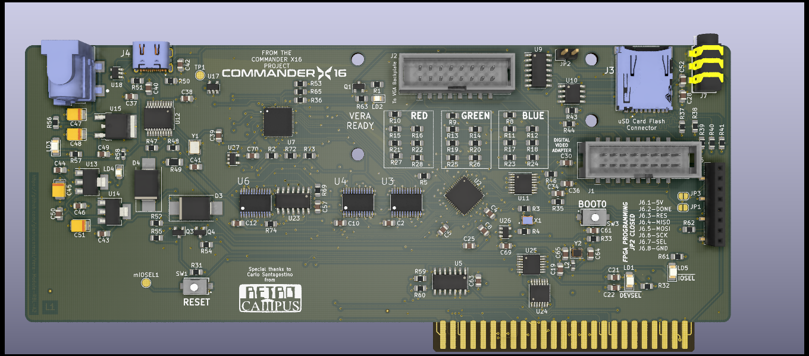
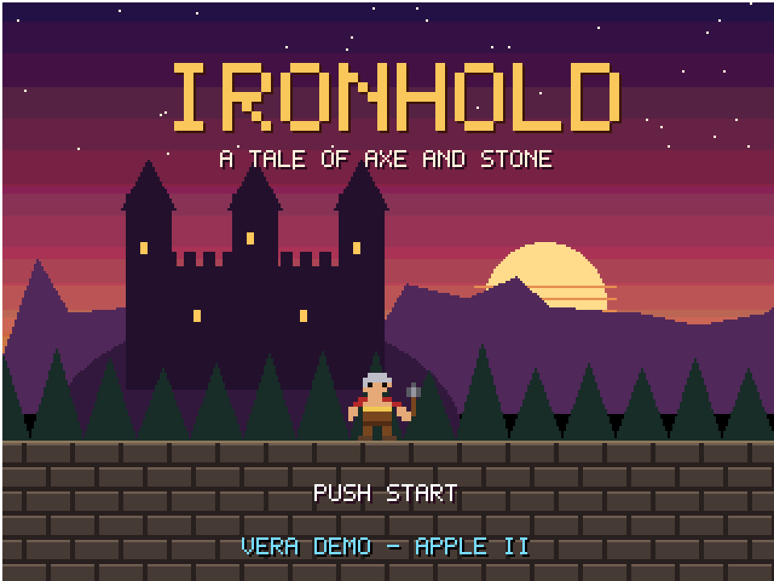
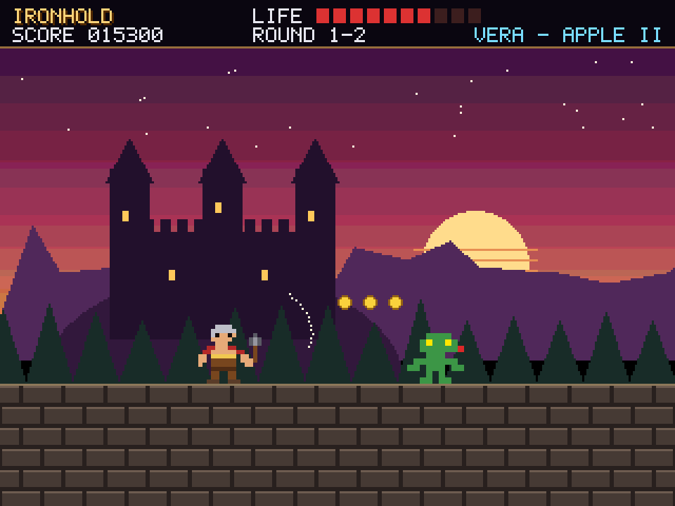
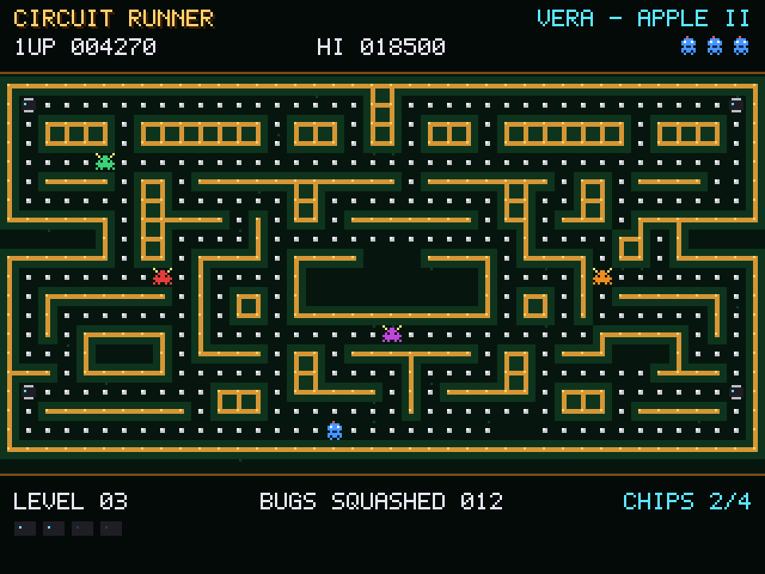
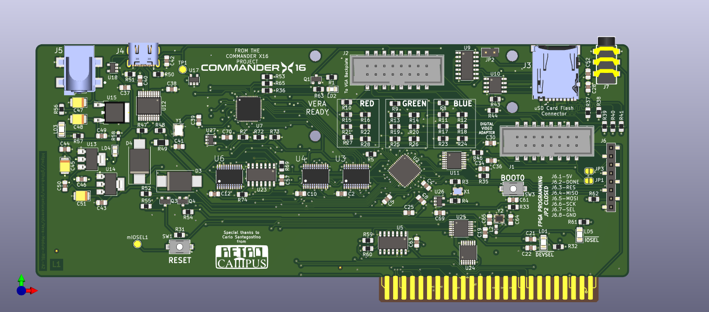
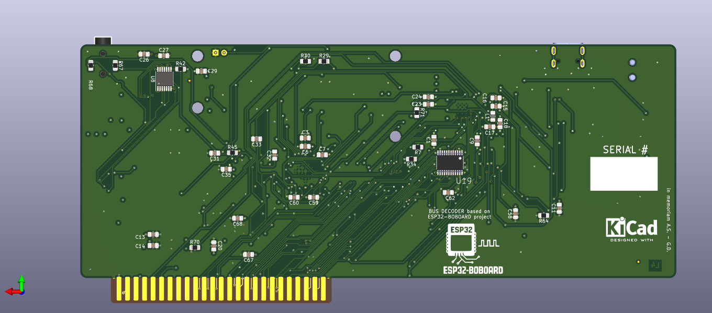
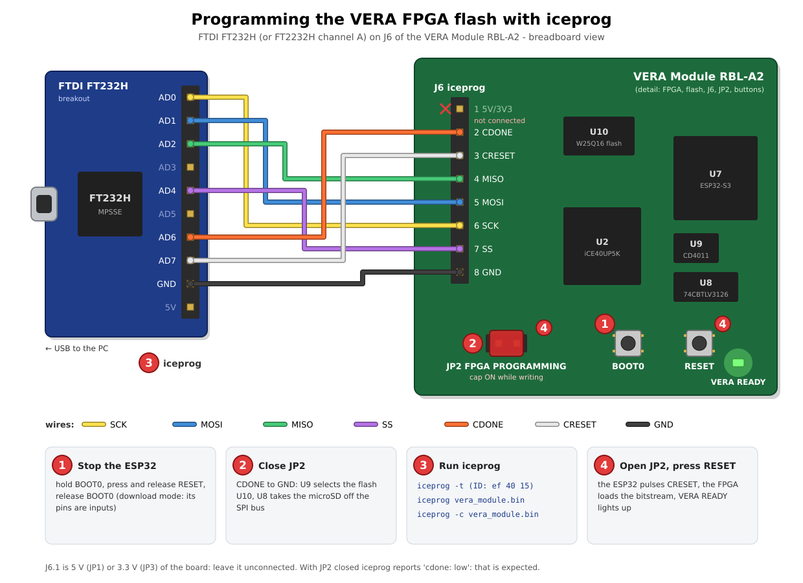
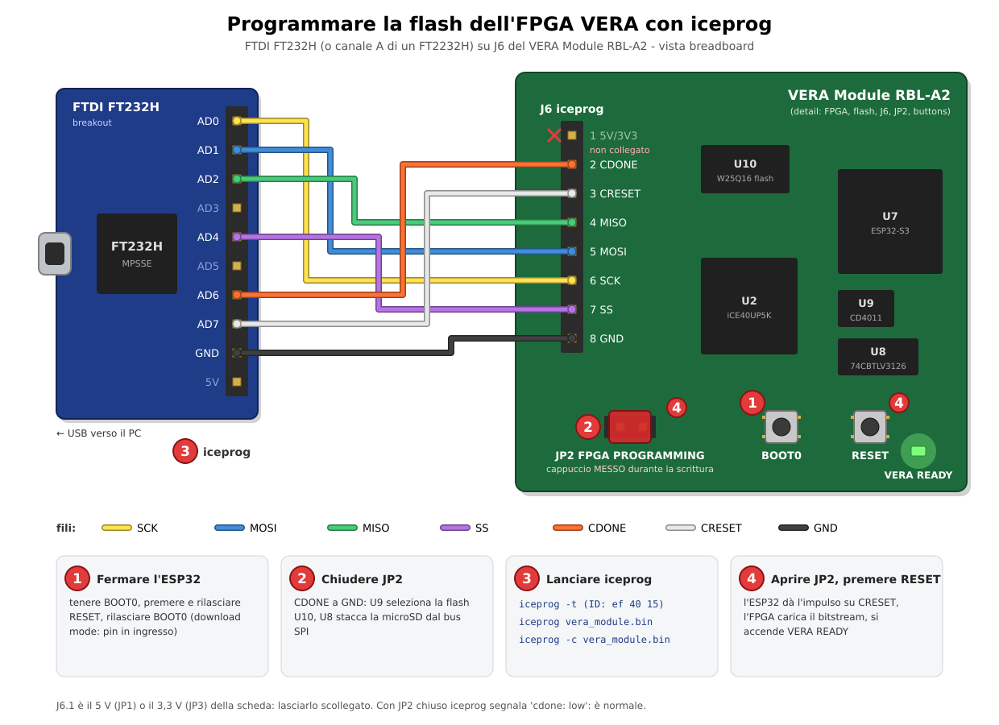

# VERA Module RBL-A2

<div align="center">

**Commander X16 graphics and sound, 256 KB of RAM disk, one Apple II slot.**

[](https://www.gnu.org/licenses/gpl-3.0)
[](#)
[](#)
[](https://www.kicad.org/)
[](https://www.espressif.com/)
[](#)



*🌐 English | [🌐 Italiano](#vera-module-rbl-a2-italiano)*

</div>

> [!WARNING]
> **WORK IN PROGRESS — NOT TESTED.** The PCB (v0.2) is routed and passes KiCad's DRC, but no
> board has been built yet. The firmware has been checked on the host and in an emulator only.

## ✨ Highlights

- 🎨 **VERA**, the Commander X16 video and audio chip, on a Lattice iCE40UP5K FPGA: two layers,
  128 sprites, 256 colours from 4096, VGA 640×480, PSG and PCM audio, SD card.
- 💾 **256 KB of expanded memory compatible with the Apple II Memory Expansion Card ("Slinky")**,
  with a ProDOS slot ROM: ProDOS sees the RAM disk `/SLINKY` at boot, no driver to load.
- ⚡ An **ESP32-S3FN8** at 240 MHz runs the slot bus in software: Slinky registers, slot ROM,
  VERA chip select.
- 🔌 **USB-C** for the ESP32 firmware (CH340C, auto-reset), **J6** to write the FPGA flash with `iceprog`.
- 📐 Full-size card drawn to **Apple IIgs Tech Note #28** (slots 1-3, fits the IIe):
  7.00" × 2.75", 4 layers.

## 🎮 What it can look like

What a game can look like on the VERA (320×240, 256 colours). These are **illustrative mock-ups
of two original demo games, not captures from the board**; `tools/make_demo_shots.py` draws them.

<div align="center">




*IRONHOLD (side-scrolling action) and CIRCUIT RUNNER (maze chase)*
</div>

## 🗺️ Memory map (slot n)

| Range | Function |
|---|---|
| `$C0n0-$C0n3` | Slinky: address bits 0-7 / 8-15 / 16-23 (`$C0n2` reads OR `$F0`), data with auto-increment |
| `$C0n4-$C0nE` | plain registers |
| `$C0nF` | bit 0 = 1: VERA registers at `$Cn00-$Cn1F`; 0: slot ROM (cleared by reset) |
| `$Cn00-$CnFF` | ProDOS slot ROM (block device, driver at `$Cn33`, `"VERAS"` at `$CnF0`) |
| `$Cn00-$Cn1F` | VERA registers, with `$C0nF` bit 0 = 1 |

After a reset the slot ROM is visible, so ProDOS finds the RAM disk. Programs show the VERA with
`$C0nF = 1`: libvera's start-up code and `vera_detect()` do it when they read `"VERAS"` at
`$CnF0`. Details: [A2-SLINKY.md](A2-SLINKY.md).

## 🔧 Hardware

| Block | Part |
|---|---|
| VERA FPGA | Lattice iCE40UP5K-SG48ITR, 25 MHz oscillator, SPI flash W25Q16 |
| Bus controller | ESP32-S3FN8 (240 MHz, 8 MB flash), 40 MHz crystal |
| Slot interface | 74LVC4245A level shifters on address, data and control |
| Audio | WM8524 I2S DAC, 3.5 mm jack |
| Video | VGA through the 2×8 header to the backplate adapter |
| USB | USB-C, CH340C USB-serial (internal clock), DTR/RTS auto-reset of the ESP32 |
| Storage | microSD |
| Power | 5 V from the slot; AMS1117 3.3 V and 1.2 V |
| PCB | 4 layers (F.Cu, 3V3 plane, GND plane, B.Cu), 177.8 × 69.85 mm |

<div align="center">


</div>

## 🏭 From KiCad to JLCPCB

```bash
./check_jlcpcb_stock.sh -n 5   # every BOM part in the JLCPCB library, with stock for 5 boards
./output_job.sh 0.2            # BOM, CPL, Gerbers, drill, iBOM, PDF, STEP/VRML, JLCPCB zip
```

- The BOM XML comes straight from the KiCad 5 schematic (`utilities/kicadcli`): it stops on a part
  without annotation or with a duplicated reference.
- **U11 WM8524** (C146242) is short at JLCPCB: it is listed in `jlcpcb-global-sourcing.txt`;
  choose **Global Sourcing** for that row when ordering.
- The board was routed from scratch with **fastroute** (`tools/route_nolimits.sh`): the result,
  reports and logs are in [routing/](routing/README.md).

Step by step, in Italian: [WORKFLOW.md](WORKFLOW.md) ([PDF](WORKFLOW.pdf)).

## 🧠 FPGA programming (iceprog)

<div align="center">

</div>

The VERA bitstream lives in the SPI flash U10 (W25Q16); the FPGA loads it at power-up.
`iceprog` writes it through **J6** with an FTDI FT232H or FT2232H adapter (MPSSE):

| J6 pin | Signal | FT232H / FT2232H (channel A) |
|---|---|---|
| 1 | 5 V (JP1) or 3.3 V (JP3), solder jumper | not needed: leave it unconnected |
| 2 | CDONE | ADBUS6 |
| 3 | CRESET | ADBUS7 |
| 4 | MISO (flash DO) | ADBUS2 |
| 5 | MOSI (flash DI) | ADBUS1 |
| 6 | SCK | ADBUS0 |
| 7 | SS (flash /CS) | ADBUS4 |
| 8 | GND | GND |

1. Power the board (in the computer) and **stop the ESP32**: hold BOOT0 (SW3), press and release
   RESET (SW1), release BOOT0. In download mode its pins are inputs; running, the firmware drives
   CRESET (GPIO 38) high against iceprog.
2. **Close JP2** ("FPGA PROGRAMMING"): CDONE goes to GND, so U9 selects the flash and U8 takes
   the microSD off the SPI bus.
3. Write and verify the flash:
   ```bash
   sudo apt install fpga-icestorm      # iceprog
   iceprog -t                          # reads the flash ID (W25Q16: ef 40 15)
   iceprog vera_module.bin             # erase, write, verify (the bitstream is not provided)
   iceprog -c vera_module.bin          # verify only
   ```
   With JP2 closed iceprog reports `cdone: low`: that is expected.
4. **Open JP2** and press RESET (SW1): the ESP32 firmware pulses CRESET, the FPGA loads the new
   bitstream and CDONE goes high (the "VERA READY" LED lights up).

## 💻 Firmware

`firmware/MCU` (PlatformIO, ESP32-S3) and the 6502 slot ROM (`firmware/MCU/6502`, cc65):

```bash
cd firmware/MCU
pio run                      # build (the slot ROM is assembled first)
pio run --target upload      # through the USB-C port (CH340C)
```

Host test: `firmware/MCU/test/host/test_a2_slinky.c`. Emulator: **a2emu-vera** with
`A2_VERA_CARD=rbl`. See [firmware/MCU/README.md](firmware/MCU/README.md).

## 📁 Repository

```
Vera-Module-RBL-A2/
├── README.md               # this file
├── A2-SLINKY.md            # Slinky memory, slot ROM, bus interface, tests
├── PIN-MAPPING.md          # ESP32-S3 pins
├── WORKFLOW.md / .pdf      # KiCad workflow, schematic to JLCPCB order (Italian)
├── VERA-MODULE-RBL.*       # KiCad 5 project: schematic and PCB
├── routing/                # fastroute result, reports and logs
├── firmware/MCU/           # ESP32-S3 firmware and 6502 slot ROM
├── docs/                   # Apple card guidelines (Tech Note #28) and links
├── images/                 # renders, demo mock-ups (images/demo)
├── tools/, *.py, *.sh      # routing, KiCad and JLCPCB production scripts
└── patches/, utilities/    # eeplot patches, kicadcli, STEP → WRL
```

Sister projects: [VERA Module RBL-XE](https://github.com/gianlucarenzi/Vera-Module-RBL-XE) (Atari
XL/XE) and [VERA Module RBL-C64](https://github.com/gianlucarenzi/Vera-Module-RBL-C64) (Commodore 64).

## 📄 License

GNU General Public License v3.0, see [LICENSE](LICENSE). VERA comes from the
[Commander X16](https://www.commanderx16.com/) project.

---

# VERA Module RBL-A2 (Italiano)

<div align="center">

**La grafica e il suono del Commander X16, 256 KB di RAM disk, uno slot dell'Apple II.**

</div>

> [!WARNING]
> **LAVORO IN CORSO — NON COLLAUDATO.** Il PCB (v0.2) è sbrogliato e passa il DRC di KiCad, ma
> nessuna scheda è stata ancora costruita. Il firmware è stato verificato solo sull'host e in
> emulatore.

## ✨ In breve

- 🎨 **VERA**, il chip video e audio del Commander X16, su FPGA Lattice iCE40UP5K: due layer,
  128 sprite, 256 colori su 4096, VGA 640×480, audio PSG e PCM, scheda SD.
- 💾 **256 KB di memoria espansa compatibile con la Apple II Memory Expansion Card ("Slinky")**,
  con ROM di slot ProDOS: al boot ProDOS vede il RAM disk `/SLINKY`, senza driver da caricare.
- ⚡ Un **ESP32-S3FN8** a 240 MHz gestisce il bus dello slot via software: registri Slinky, ROM di
  slot, chip select della VERA.
- 🔌 **USB-C** per il firmware dell'ESP32 (CH340C, reset automatico), **J6** per scrivere la flash
  dell'FPGA con `iceprog`.
- 📐 Scheda a tutta lunghezza secondo l'**Apple IIgs Tech Note #28** (slot 1-3, va bene anche per
  il IIe): 7,00" × 2,75", 4 layer.

## 🎮 Come potrebbe apparire

Come può apparire un gioco sulla VERA (320×240, 256 colori). Sono **immagini dimostrative di due
giochi originali, non catture dalla scheda**; le disegna `tools/make_demo_shots.py`.

<div align="center">


</div>

## 🗺️ Mappa della memoria (slot n)

| Indirizzi | Funzione |
|---|---|
| `$C0n0-$C0n3` | Slinky: bit 0-7 / 8-15 / 16-23 dell'indirizzo (`$C0n2` letto OR `$F0`), dato con autoincremento |
| `$C0n4-$C0nE` | registri semplici |
| `$C0nF` | bit 0 = 1: registri VERA in `$Cn00-$Cn1F`; 0: ROM di slot (azzerato dal reset) |
| `$Cn00-$CnFF` | ROM di slot ProDOS (dispositivo a blocchi, driver a `$Cn33`, `"VERAS"` a `$CnF0`) |
| `$Cn00-$Cn1F` | registri VERA, con `$C0nF` bit 0 = 1 |

Dopo un reset è visibile la ROM, così ProDOS trova il RAM disk. I programmi mostrano la VERA con
`$C0nF = 1`: lo fanno il codice d'avvio di libvera e `vera_detect()` quando leggono `"VERAS"` in
`$CnF0`. Dettagli: [A2-SLINKY.md](A2-SLINKY.md).

## 🔧 Hardware

| Blocco | Parte |
|---|---|
| FPGA VERA | Lattice iCE40UP5K-SG48ITR, oscillatore 25 MHz, flash SPI W25Q16 |
| Controller di bus | ESP32-S3FN8 (240 MHz, 8 MB di flash), quarzo 40 MHz |
| Interfaccia slot | traslatori 74LVC4245A su indirizzi, dati e controlli |
| Audio | DAC I2S WM8524, jack 3,5 mm |
| Video | VGA tramite il connettore 2×8 verso l'adattatore sulla staffa |
| USB | USB-C, CH340C USB-seriale (clock interno), reset automatico dell'ESP32 con DTR/RTS |
| Memoria | microSD |
| Alimentazione | 5 V dallo slot; AMS1117 da 3,3 V e 1,2 V |
| PCB | 4 layer (F.Cu, piano 3V3, piano GND, B.Cu), 177,8 × 69,85 mm |

## 🏭 Da KiCad a JLCPCB

```bash
./check_jlcpcb_stock.sh -n 5   # ogni parte della BOM nella libreria JLCPCB, stock per 5 schede
./output_job.sh 0.2            # BOM, CPL, Gerber, forature, iBOM, PDF, STEP/VRML, zip JLCPCB
```

- L'XML della BOM viene direttamente dallo schema KiCad 5 (`utilities/kicadcli`): si ferma su un
  componente non annotato o con riferimento duplicato.
- **U11 WM8524** (C146242) scarseggia da JLCPCB: è in `jlcpcb-global-sourcing.txt`; nell'ordine si
  sceglie **Global Sourcing** per quella riga.
- La scheda è stata sbrogliata da zero con **fastroute** (`tools/route_nolimits.sh`): risultato,
  report e log sono in [routing/](routing/README.md).

Passo per passo: [WORKFLOW.md](WORKFLOW.md) ([PDF](WORKFLOW.pdf)).

## 🧠 Programmazione dell'FPGA (iceprog)

<div align="center">

</div>

Il bitstream della VERA sta nella flash SPI U10 (W25Q16); l'FPGA lo carica all'accensione.
`iceprog` lo scrive tramite **J6** con un adattatore FTDI FT232H o FT2232H (MPSSE):

| Pin J6 | Segnale | FT232H / FT2232H (canale A) |
|---|---|---|
| 1 | 5 V (JP1) o 3,3 V (JP3), ponticello a saldare | non serve: lasciarlo scollegato |
| 2 | CDONE | ADBUS6 |
| 3 | CRESET | ADBUS7 |
| 4 | MISO (DO della flash) | ADBUS2 |
| 5 | MOSI (DI della flash) | ADBUS1 |
| 6 | SCK | ADBUS0 |
| 7 | SS (/CS della flash) | ADBUS4 |
| 8 | GND | GND |

1. Alimentare la scheda (nel computer) e **fermare l'ESP32**: tenere premuto BOOT0 (SW3),
   premere e rilasciare RESET (SW1), rilasciare BOOT0. In download mode i suoi pin sono ingressi;
   se gira, il firmware tiene CRESET (GPIO 38) alto contro iceprog.
2. **Chiudere JP2** ("FPGA PROGRAMMING"): CDONE va a GND, così U9 seleziona la flash e U8 stacca
   la microSD dal bus SPI.
3. Scrivere e verificare la flash:
   ```bash
   sudo apt install fpga-icestorm      # iceprog
   iceprog -t                          # legge l'ID della flash (W25Q16: ef 40 15)
   iceprog vera_module.bin             # cancella, scrive, verifica (il bitstream non è fornito)
   iceprog -c vera_module.bin          # solo verifica
   ```
   Con JP2 chiuso iceprog segnala `cdone: low`: è normale.
4. **Aprire JP2** e premere RESET (SW1): il firmware dell'ESP32 dà l'impulso su CRESET, l'FPGA
   carica il nuovo bitstream e CDONE va alto (si accende il LED "VERA READY").

## 💻 Firmware

`firmware/MCU` (PlatformIO, ESP32-S3) e la ROM di slot 6502 (`firmware/MCU/6502`, cc65):

```bash
cd firmware/MCU
pio run                      # compila (prima assembla la ROM di slot)
pio run --target upload      # dalla porta USB-C (CH340C)
```

Test host: `firmware/MCU/test/host/test_a2_slinky.c`. Emulatore: **a2emu-vera** con
`A2_VERA_CARD=rbl`. Vedi [firmware/MCU/README.md](firmware/MCU/README.md).

Progetti gemelli: [VERA Module RBL-XE](https://github.com/gianlucarenzi/Vera-Module-RBL-XE) (Atari
XL/XE) e [VERA Module RBL-C64](https://github.com/gianlucarenzi/Vera-Module-RBL-C64) (Commodore 64).

## 📄 Licenza

GNU General Public License v3.0, vedi [LICENSE](LICENSE). La VERA viene dal progetto
[Commander X16](https://www.commanderx16.com/).
