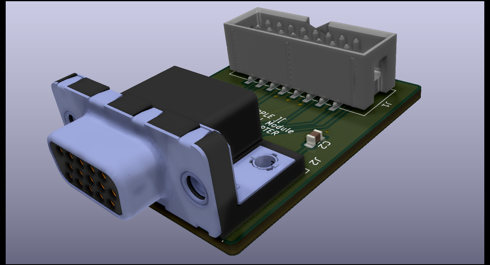
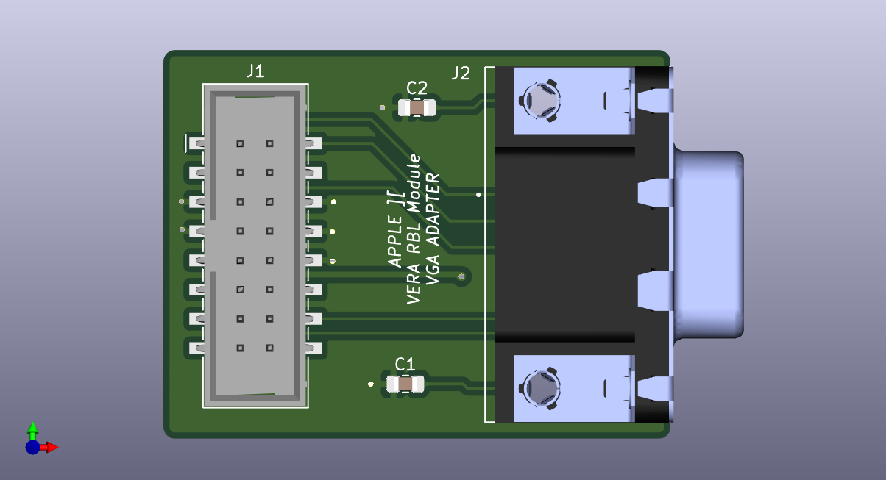
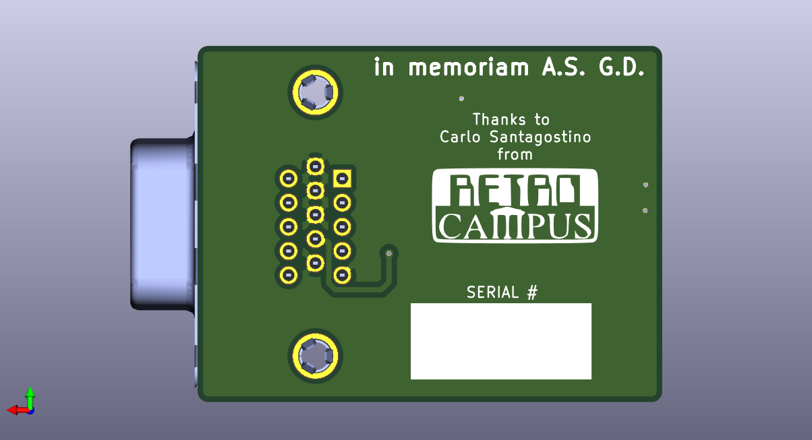

# VGA-Extender for the VERA Module RBL-A2

<div align="center">

**The VGA output of the VERA Module RBL-A2, out of the Apple II case.**

[](https://www.gnu.org/licenses/gpl-3.0)
[](https://www.kicad.org/)
[](#)



*🌐 English | [🌐 Italiano](#vga-extender-per-il-vera-module-rbl-a2-italiano)*

</div>

## ✨ What it is

A small 2-layer board (44.1 × 33.8 mm) with a **VGA (HD15 female) connector**, to fix on a
rear slot bracket of the Apple II. It is linked to the **J2** 2×8 box header of the VERA Module
RBL-A2 with a **16-way IDC ribbon cable**: the card itself has no VGA connector, only the header.

| | |
|---|---|
| J1 | 2×8 SMD box header (HX JN2.54-2x8P, LCSC C41376031), to the card |
| J2 | VGA HD15 female, right angle (Connfly DS1038-15FBNSiA74-0CC, LCSC C75754, through-hole) |
| C1, C2 | 100 nF from each shield lug to GND (LCSC C28233) |
| cable | 16-way 1.27 mm grey ribbon with two IDC 2×8 sockets (e.g. Connfly DS1016-16MANBG, LCSC C7500469), crimped by hand |

## 🔌 Pinout

The header pins go straight to the VGA pins of the same number (1:1), as on J2 of the card:

| Pin | Signal | Pin | Signal |
|---|---|---|---|
| 1 | RED | 9 | +5 V |
| 2 | GREEN | 10 | GND |
| 3 | BLUE | 11, 12 | not connected |
| 4 | not connected | 13 | HSYNC |
| 5-8 | GND | 14 | VSYNC |
| | | 15, 16 | not connected (16: header only) |

The connector shell (S1, S2) goes to GND through C1 and C2.

<div align="center">


</div>

## 🏭 From KiCad to JLCPCB

The same scripts as the main project:

```bash
./check_jlcpcb_stock.sh -n 5   # every BOM part in the JLCPCB library, with stock for 5 boards
./output_job.sh 1.0            # BOM, CPL, Gerbers, drill, iBOM, PDF, STEP/VRML, JLCPCB zip
```

The result is `VERA-VGA-Extender-A2-v1.0.zip` (Gerbers and drill from `production/`) with
`VERA-VGA-Extender-A2-v1.0-JLCPCB-BOM.csv` and `-CPL.csv`, the interactive BOM in
`ibom/ibom.html`, the schematic in `VGA-Extender.pdf` and the 3D models in `images/`. KiCad 5 comes
from the system when it is version 5, otherwise from the KiCad 5 AppImage (`kicad5`); see the
[WORKFLOW](../WORKFLOW.md) of the main project.

J2 is through-hole: JLCPCB solders it by hand with the Standard PCBA (a few cents a board). With
only three SMD parts the board can also be assembled by hand.

## 📄 License

GNU General Public License v3.0, see [LICENSE](../LICENSE).

---

# VGA-Extender per il VERA Module RBL-A2 (Italiano)

<div align="center">

**L'uscita VGA del VERA Module RBL-A2, fuori dal case dell'Apple II.**

</div>

## ✨ Cos'è

Una piccola scheda a 2 layer (44,1 × 33,8 mm) con un **connettore VGA (HD15 femmina)**, da fissare
su una staffa posteriore dell'Apple II. Si collega al connettore box 2×8 **J2** del VERA Module
RBL-A2 con un **cavo piatto IDC a 16 poli**: la scheda principale non ha il connettore VGA, solo il
connettore box.

| | |
|---|---|
| J1 | connettore box 2×8 SMD (HX JN2.54-2x8P, LCSC C41376031), verso la scheda |
| J2 | VGA HD15 femmina ad angolo retto (Connfly DS1038-15FBNSiA74-0CC, LCSC C75754, THT) |
| C1, C2 | 100 nF da ogni linguetta dello schermo a GND (LCSC C28233) |
| cavo | piattina grigia a 16 poli, passo 1,27 mm, con due connettori IDC 2×8 (per esempio Connfly DS1016-16MANBG, LCSC C7500469), crimpati a mano |

## 🔌 Piedinatura

I pin del connettore box vanno dritti ai pin VGA con lo stesso numero (1:1), come J2 della scheda:

| Pin | Segnale | Pin | Segnale |
|---|---|---|---|
| 1 | ROSSO | 9 | +5 V |
| 2 | VERDE | 10 | GND |
| 3 | BLU | 11, 12 | non collegati |
| 4 | non collegato | 13 | HSYNC |
| 5-8 | GND | 14 | VSYNC |
| | | 15, 16 | non collegati (il 16 c'è solo sul connettore box) |

Lo schermo del connettore (S1, S2) va a GND attraverso C1 e C2.

## 🏭 Da KiCad a JLCPCB

Gli stessi script del progetto principale:

```bash
./check_jlcpcb_stock.sh -n 5   # ogni parte della BOM nella libreria JLCPCB, stock per 5 schede
./output_job.sh 1.0            # BOM, CPL, Gerber, forature, iBOM, PDF, STEP/VRML, zip JLCPCB
```

Il risultato è `VERA-VGA-Extender-A2-v1.0.zip` (Gerber e forature da `production/`), con
`VERA-VGA-Extender-A2-v1.0-JLCPCB-BOM.csv` e `-CPL.csv`, la BOM interattiva in `ibom/ibom.html`,
lo schema in `VGA-Extender.pdf` e i modelli 3D in `images/`. KiCad 5 viene dal sistema se è la
versione 5, altrimenti dall'AppImage di KiCad 5 (`kicad5`); vedi il [WORKFLOW](../WORKFLOW.md) del
progetto principale.

J2 è THT: JLCPCB lo salda a mano con lo Standard PCBA (pochi centesimi a scheda). Con soli tre
componenti SMD la scheda si può anche montare a mano.

## 📄 Licenza

GNU General Public License v3.0, vedi [LICENSE](../LICENSE).
